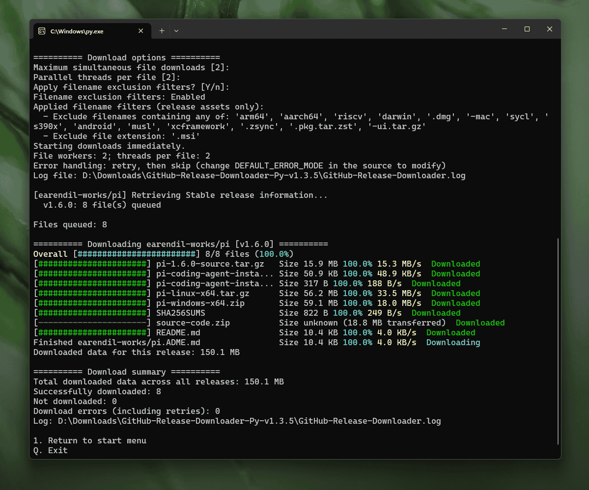

# GitHub Release Downloader Py

An interactive command-line tool for downloading GitHub Release assets from selected repositories. It supports Stable and Pre-release channels, direct release-tag URLs, filename filters, parallel downloads, resumable transfers, SHA-256 verification, and error logging.

**Main file:** `github_release_downloader.py`  
**Version:** `1.3.5`  
**Python dependencies:** Standard library only; no third-party packages are required.



## Features

- Download the latest published **Stable** or **Pre-release** release from configured repositories.
- Download a specific published release using a URL such as `https://github.com/OWNER/REPOSITORY/releases/tag/TAG`.
- Select multiple repositories using numbers and ranges, for example `1, 2, 5-8`.
- Configure repositories, filename filters, Boolean download options, concurrency, retries, and error handling near the top of the source file.
- Choose at startup whether the configured filename exclusion patterns should be applied.
- Display the exact active filename filters before downloads begin, including exclusion patterns, include-only keywords, and the `.msi` restriction when enabled.
- Independently enable or disable MSI installers, the release source ZIP, and the repository README.
- Choose the maximum number of simultaneous file downloads and the number of parallel streams per file (default: 2).
- Show multi-color per-file progress and overall queue progress using ANSI terminal sequences and the Python standard library.
- Enable Windows Virtual Terminal (VT) processing automatically when supported, including classic Windows console hosts.
- Fall back to plain-text progress snapshots when ANSI/VT control sequences are unavailable.
- Adapt progress-row detail and filename width to the current terminal width to reduce unwanted line wrapping.
- Use parallel HTTP Range requests for supported servers, with automatic single-stream fallback when ranges are unavailable.
- Resume incomplete downloads on a later run.
- Verify SHA-256 when GitHub provides an asset digest.
- Skip existing non-empty destination files.
- Detect GitHub authentication through `GH_TOKEN`, `GITHUB_TOKEN`, or an authenticated GitHub CLI installation.
- Log errors and events to `GitHub-Release-Downloader.log` while redacting signed URL query strings and authorization tokens.
- Show a final report of files and repositories that could not be downloaded or prepared.
- Return to the start menu or exit after a download session.

## Requirements

- Python **3.10 or newer**.
- Internet access to GitHub API and release-download hosts.
- No external Python packages.

## Run

1. Download or clone the project.
2. Open a terminal in the project directory.
3. Run:

   ```bash
   python github_release_downloader.py
   ```

On Windows, you can also use:

```powershell
py .\github_release_downloader.py
```

There is no `requirements.txt` file and no `pip install` step.

## Main menu

The start menu provides two download modes:

1. **Download the latest release from the configured repository list** — select one or more repositories.
2. **Download a specific release by GitHub URL** — paste a published tag URL in this form:

   ```text
   https://github.com/OWNER/REPOSITORY/releases/tag/TAG
   ```

Draft releases are not supported.

### Repository selection

The repository selection starts with nothing selected. Enter individual numbers, ranges, or combinations separated by commas, semicolons, or spaces:

```text
1, 2, 5-8
```

Prefix a number or range with `-` to remove it from the current selection:

```text
-3, -7-9
```

Shortcuts:

| Input | Action |
|---|---|
| `1, 2, 5-8` | Select the specified repositories. |
| `-3` | Remove repository 3 from the current selection. |
| `A` | Select all repositories. |
| `N` | Clear the selection. |
| `Enter` | Confirm the selection. At least one repository must be selected. |
| `Q` | Return to the start menu. |

## Configure repositories and defaults

Open `github_release_downloader.py` in a text editor. The `REPOSITORIES` list and the `USER SETTINGS` block are located near the beginning of the file.

### Repository list

```python
REPOSITORIES = [
    {"owner": "octocat", "name": "Hello-World", "channel": "Stable"},
    {"owner": "some-project", "name": "another-project", "channel": "Pre-release"},
]
```

- `owner`: GitHub user or organization.
- `name`: repository name.
- `channel`: `Stable` or `Pre-release`.

Add, edit, or remove entries directly in this list.

### User settings and filename filters

```python
DEFAULT_EXCLUSIONS = ["arm64", "aarch64", "riscv", "darwin", ".dmg"]
DEFAULT_INCLUDES = []       # Empty means no include-only restriction
APPLY_DEFAULT_EXCLUSIONS = True  # Default answer to the startup filter prompt
DOWNLOAD_MSI = True
DOWNLOAD_SOURCE_ZIP = True
DOWNLOAD_README = True

DEFAULT_MAX_WORKERS = 2
DEFAULT_THREADS_PER_FILE = 2
DEFAULT_RETRIES = 2
DEFAULT_ERROR_MODE = 3
USE_ANSI_COLORS = True
```

- `DEFAULT_EXCLUSIONS`: case-insensitive literal filename fragments to exclude.
- `DEFAULT_INCLUDES`: if non-empty, only release assets whose filenames contain at least one listed keyword are eligible.
- `APPLY_DEFAULT_EXCLUSIONS`: default answer to the startup question about applying `DEFAULT_EXCLUSIONS`. The choice can be changed for each run.
- `DOWNLOAD_MSI`: set to `False` to exclude `.msi` assets.
- `DOWNLOAD_SOURCE_ZIP` and `DOWNLOAD_README`: control whether the release source ZIP and repository README are queued.
- `DEFAULT_MAX_WORKERS`: default number of files downloaded simultaneously.
- `DEFAULT_THREADS_PER_FILE`: default number of parallel HTTP streams per file; default is 2.
- `DEFAULT_RETRIES`: retry setting for failed downloads or ranges.
- `DEFAULT_ERROR_MODE`: error policy: `1` skips and continues, `2` asks what to do after an error, and `3` retries before skipping.
- `USE_ANSI_COLORS`: set to `False` to disable terminal colors.

Filename matching is case-insensitive and uses literal substrings, not regular expressions or wildcards. Filename filters apply to release assets only; they do not filter `source-code.zip` or `README.md`.

### Filter summary shown at startup

After the exclusion-filter question, the script prints the exact active filename filters before it starts downloading. For example:

```text
Filename exclusion filters: Enabled
Applied filename filters (release assets only):
  - Exclude filenames containing any of: 'arm64', 'aarch64', 'riscv', 'darwin', '.dmg'
  - Include only filenames containing at least one of: 'cuda', 'windows'
  - Exclude file extension: '.msi'
```

Only active rules are listed. If no filename filters are active, the script reports that all release asset filenames are eligible. This summary helps verify which patterns will affect the current run.

## Startup and download flow

At the beginning of a download session, the script asks for:

1. Maximum simultaneous file downloads.
2. Number of parallel streams per file.
3. Whether to apply the configured filename exclusion filters, if the exclusion list is not empty.

The default values are shown in each numeric prompt. After the filter choice and its summary, downloads begin automatically; there is no separate start confirmation.

The error-handling mode is not requested interactively. The active mode is displayed as information and can be changed through `DEFAULT_ERROR_MODE` in the source file.

## Progress display and colors

The terminal shows an overall queue progress bar and an individual row for each file. Every row displays the expected file size when it is available from GitHub metadata or the download response, along with percentage, transferred/total bytes, transfer speed, and ETA where the layout permits. If the size cannot be determined, the row explicitly shows `Size unknown` and the amount transferred so far. The separate `Working` status line indicates active transfers.

Different elements use different ANSI colors: progress bars, percentages, speed, ETA, filename/byte information, and status indicators are visually distinct. The overall progress is also highlighted. No external terminal or color package is used.

Colors and cursor-based progress updates are enabled automatically in interactive terminals when ANSI/VT support is available. On Windows, the script attempts to enable `ENABLE_VIRTUAL_TERMINAL_PROCESSING` through the Windows console API. If that operation is unavailable or fails, the downloader switches to plain-text progress snapshots and does not emit ANSI cursor-control sequences. This fallback keeps downloading functional on older or restricted console hosts.

The progress layout also checks the available terminal width and uses a more compact row on narrower windows. Colors can be disabled by setting `NO_COLOR=1` or changing `USE_ANSI_COLORS` to `False`.

Parallel range downloading is used when the file size is known, the file is sufficiently large, and the server supports HTTP Range. Otherwise, the downloader automatically falls back to a single stream.

## GitHub authentication (optional)

A token is not required for public repositories. To increase API rate limits, set an environment variable:

```bash
# Linux / macOS
export GH_TOKEN="YOUR_GITHUB_TOKEN"
```

PowerShell:

```powershell
$env:GH_TOKEN = "YOUR_GITHUB_TOKEN"
```

The script also recognizes `GITHUB_TOKEN` and can reuse an authenticated GitHub CLI session. Never hard-code a personal access token in the source file or commit it to the repository.

## Output files and logs

Downloads are saved in folders named `<repository>-<release-tag>` beside the script. Temporary download data uses `.part` or `.partN` suffixes. Successfully completed parallel parts are merged into the final file; incomplete data is retained for a later resume attempt where possible.

Errors and diagnostic events are appended to `GitHub-Release-Downloader.log`. After each release, the script reports the total size of files successfully downloaded for that release. The final session summary reports the combined size of successfully downloaded files across all processed releases, followed by the success/error counts and any files or repositories that could not be downloaded or prepared. Existing files that were skipped are not included in these download-volume totals.

After the session, choose whether to return to the start menu or exit the program.

## Troubleshooting

### GitHub API returns `403 Forbidden` or a rate-limit error

Use an authenticated GitHub CLI session (`gh auth login`) or set `GH_TOKEN` / `GITHUB_TOKEN`. If the API reports that the rate limit is exhausted, wait until the reset time before retrying.

### No published release is found

Check the repository's `channel` value. Use `Pre-release` for projects publishing pre-release builds and `Stable` for regular releases. A Git tag by itself is not necessarily a published GitHub Release.

### A specific release URL is rejected

Use a published tag URL in this form:

```text
https://github.com/OWNER/REPOSITORY/releases/tag/TAG
```

The script does not support draft releases, arbitrary web pages, or non-GitHub release hosts.

### A download fails or stops unexpectedly

Check the `[DOWNLOAD ERROR]` message in the console and inspect `GitHub-Release-Downloader.log`. Review available disk space, write permissions, network connectivity, and the reported error. Run the script again to retry or resume unfinished downloads. If GitHub returns a rate-limit or access-denied response, wait and try again later.

## Safety and responsible use

- The script reads release metadata from the GitHub REST API and downloads files from URLs returned for selected releases. It does not publish releases or modify repositories.
- Downloaded executables and archives are third-party files. Review the upstream project, verify checksums or signatures when available, and scan files according to your normal security practices before running them.
- Downloading a file does not grant permission to redistribute it. Follow the license terms of each upstream project and asset.
- Use reasonable concurrency and respect GitHub API rate limits and bandwidth policies.
- This project is not affiliated with or endorsed by GitHub.

## Useful links

- [GitHub REST API: Releases](https://docs.github.com/en/rest/releases/releases)
- [GitHub REST API rate limits](https://docs.github.com/en/rest/using-the-rest-api/rate-limits-for-the-rest-api)
- [GitHub CLI](https://cli.github.com/)

## Credits
The code was written using web version of ChatGPT 😁.

## License

[MIT](LICENSE)